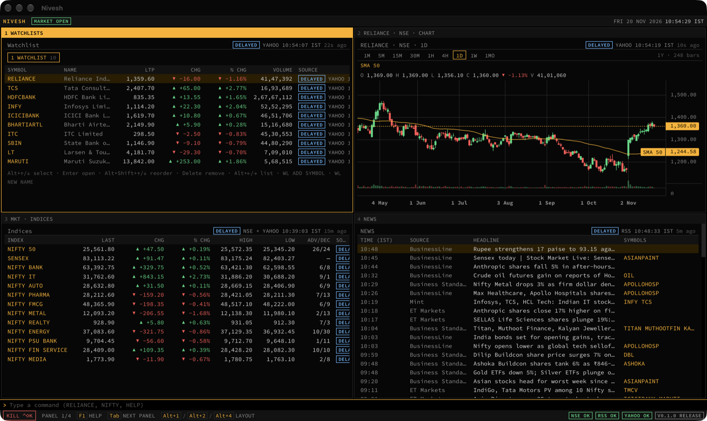
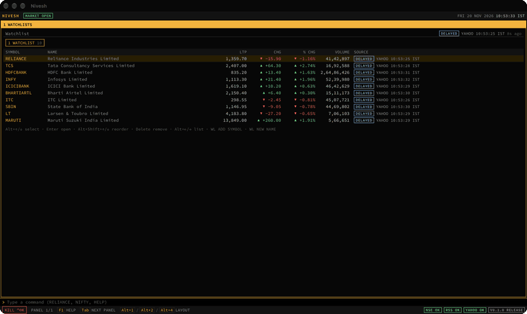
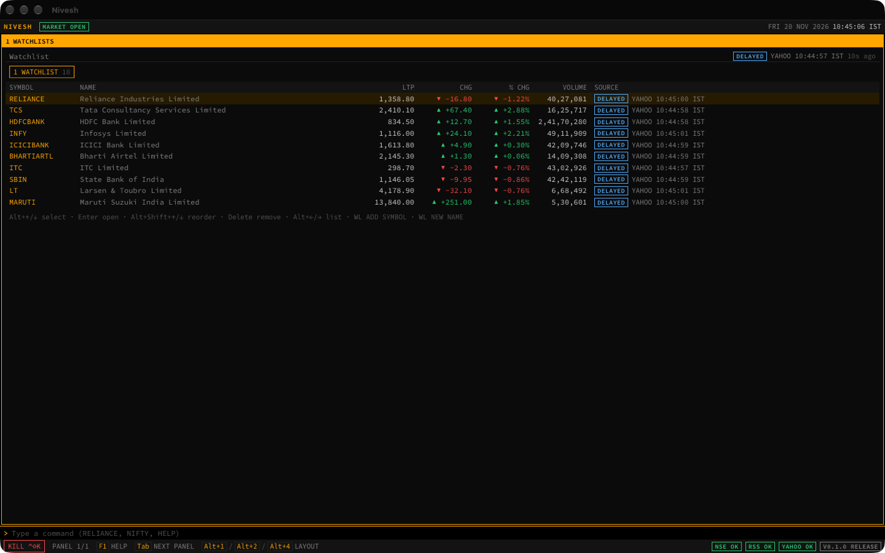
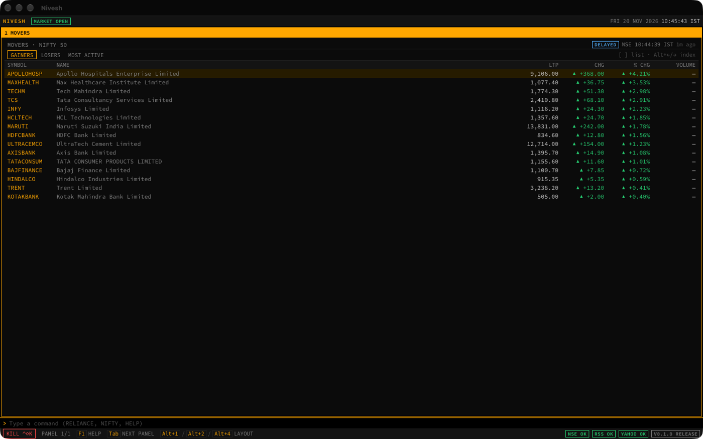
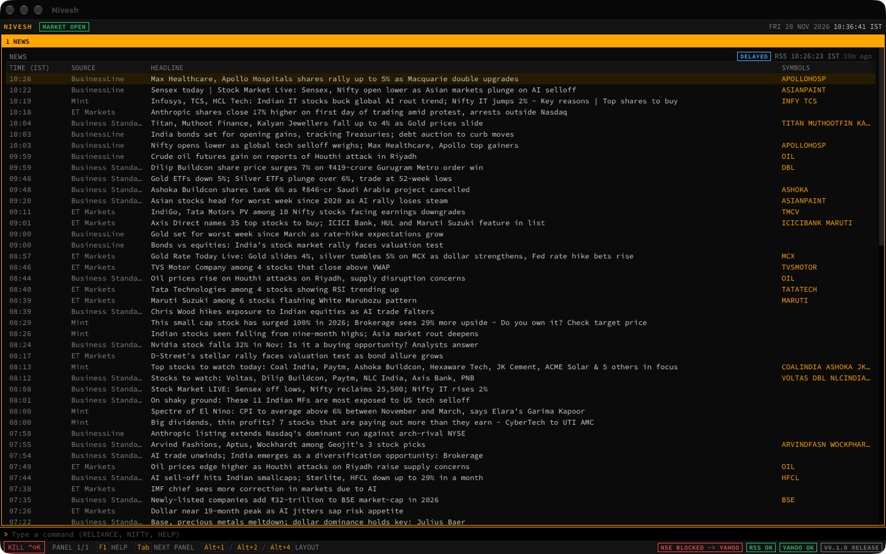
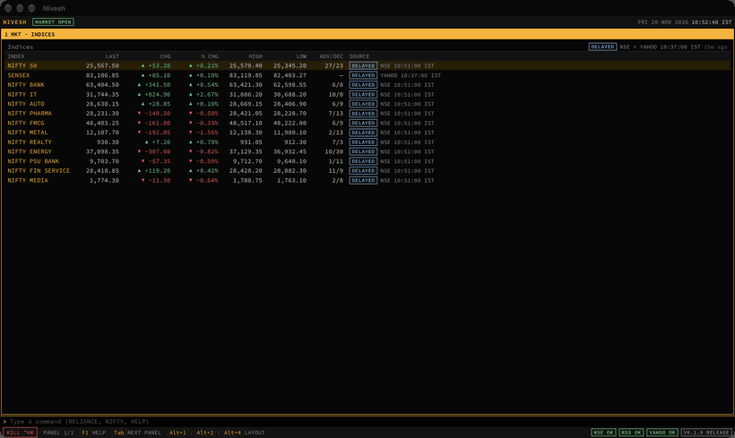
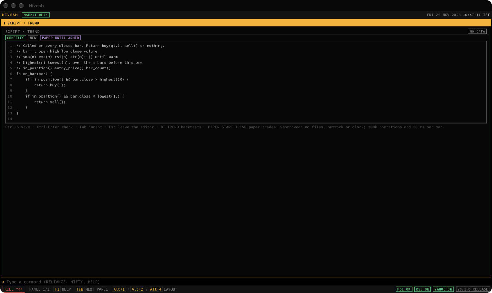
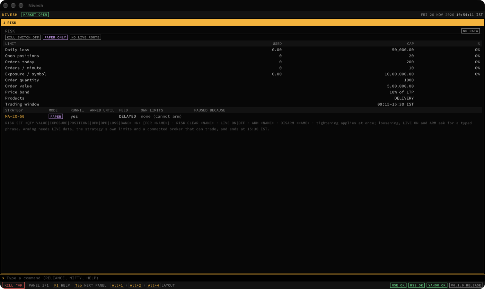

# Nivesh

**A fast, keyboard-first market screen for Indian stocks.** Watch your
favourite shares and try out trading ideas on paper. It's free and runs on
your Mac.



Nivesh puts Indian market information on one screen:

- prices
- charts
- the big indices
- top gainers and losers
- news

You use it by typing, the way professionals use a Bloomberg terminal. Type a
company's name and press Enter, and its price is on screen.

It also lets you try out trading ideas on past prices and with pretend money.
You see how an idea would have done before it ever touches real money.



---

## Download

**For Macs with Apple silicon (M1, M2, M3, M4 or M5).**

**[⬇ Download Nivesh for Mac](https://github.com/akshatiwarix/nivesh/releases/latest/download/Nivesh_aarch64.dmg)**

### Installing it

1. Open the downloaded **Nivesh_aarch64.dmg** file.
2. Drag **Nivesh** into your **Applications** folder.
3. Open your Applications folder, then **right-click** Nivesh and choose
   **Open**. Click **Open** again when your Mac asks.

You only do step 3 the first time. After that, open Nivesh like any other app.

**If your Mac says Nivesh "can't be opened" or "is damaged":** Nivesh isn't
signed with an Apple developer certificate yet, so macOS is being careful. To
open it anyway:

1. Open **System Settings → Privacy & Security**.
2. Scroll down until you see the message about Nivesh.
3. Click **Open Anyway**.

If that button isn't there, open the **Terminal** app, paste the line below,
press Enter, and open Nivesh again:

```
xattr -dr com.apple.quarantine /Applications/Nivesh.app
```

---

## Getting started

When Nivesh opens, a short welcome note explains how it works. After that,
just start typing. Whatever you type goes into the bar at the bottom of the
window.

| Type this | And press Enter to |
|---|---|
| `RELIANCE` | see Reliance's price today |
| `RELIANCE CH` | see Reliance's price chart |
| `WL` | see your watchlist (it starts with ten big companies) |
| `WL ADD TITAN` | add a company to your watchlist |
| `MKT` | see the main indices: Nifty 50, Sensex, Bank Nifty and more |
| `MOV` | see today's biggest gainers and losers |
| `NEWS` | read the latest market headlines |
| `HELP` | see everything Nivesh can do |

A few keys help you move around:

- **Alt+1**, **Alt+2** or **Alt+4** splits the screen into 1, 2 or 4 panels.
- **Tab** moves between panels.
- **Esc** goes back.

Each panel can show something different.



### Charts

Type `RELIANCE CH` for a chart. Then type `ADD SMA 50` to draw the 50-day
average on it. The keys **+** and **−** zoom in and out, and **←** and **→**
move through time.

### What's moving today

`MOV` lists today's biggest gainers and losers among the Nifty 50.



`NEWS` shows headlines from Indian business papers, with the companies they
mention. Press Enter on a headline to read it in your browser.



---

## Trying out trading ideas with pretend money

You can describe a simple trading idea and see how it would have done, using
real past prices.

For example, "buy when the 20-day average crosses above the 50-day average":

1. Type `STRAT MA 20 50 1` to create the idea. It gets a short name, here
   **MA-20-50**.
2. Type `BT MA-20-50 RELIANCE 1D 5Y` to test it on five years of Reliance.

Nivesh shows every pretend trade on the chart, along with what each one
would have made or lost after brokerage charges.



When an idea looks good, `PAPER START MA-20-50` runs it on new prices as they
come in, still with pretend money. `PAPER` shows how it's doing.

If you're comfortable with a little code, `SCRIPT MYIDEA` opens a small editor
where you can write your own rules.



**Everything here uses pretend money.** Nivesh does not place real trades in
this version.

---

## Good to know

**The prices are a few minutes late.** Nivesh gets prices from free public
sources, which run behind the live market. Every panel says **DELAYED** and
shows when its prices are from. Don't use these numbers for split-second
decisions.

**Nivesh is not investment advice.** It's a tool for looking at the market
and testing ideas. How an idea did in the past doesn't promise how it will
do in the future. Any trading decision, and any money you make or lose, is
yours.

**Your data stays on your Mac.** There's no account and no sign-up, and
Nivesh doesn't send anything about you anywhere. It only asks the public
sources for prices and news.

**There's a big red stop button.** The **KILL** button at the bottom left, or
**Ctrl+Shift+K**, stops all trading activity at once. It matters most once
real trading arrives, but it's there from day one.



---

## Questions

**Does it work on Windows, Linux, or older Intel Macs?**
Not as a download yet. For now it's Macs with Apple silicon only.

**Do I need a Zerodha account?**
No. Everything above works without one. A Zerodha Kite connection, for live
prices and your own holdings, is planned. To see what that screen looks like,
type `LOGIN DEMO` and then `PORT`. It shows a pretend portfolio.

**It says "NSE BLOCKED" at the bottom.**
The NSE website sometimes turns away automated requests for a few minutes.
When that happens, Nivesh switches to another source by itself, so you can
carry on.

**Something isn't working.**
Please [open an issue](https://github.com/akshatiwarix/nivesh/issues) and
describe what you typed and what you saw.

---

## For developers

Building Nivesh from source, running the tests and the project layout are all
in [docs/DEVELOPING.md](docs/DEVELOPING.md). The safety rules for anything
near real orders are in [docs/TRADING_SAFETY.md](docs/TRADING_SAFETY.md).

The bundled font, Source Code Pro, is under the SIL Open Font License 1.1.
